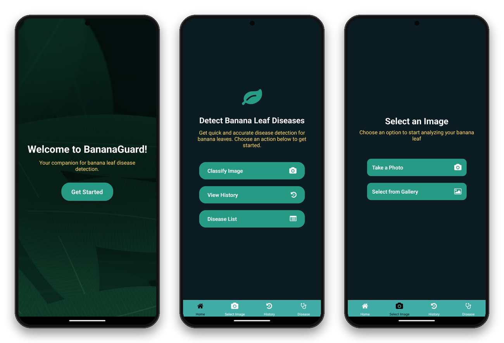

# BananaGuard 🍌

Mobile app for detecting diseases in banana leaves from a photo, built as part of my
**Master's thesis in Artificial Intelligence** at Universidad Internacional de Valencia (VIU):

> *Banana Leaf Disease Detection Using Convolutional Neural Networks (CNNs) Through a Mobile App*


<p align="center"></p>

The goal is simple: a farmer takes a picture of a leaf and gets a fast, offline-friendly
diagnosis, plus a history of past checks and a reference list of common diseases.

## Status

This repository contains the **mobile client** of the project. The CNN was trained and evaluated as part of the
thesis research; the trained model is no longer available, so the app covers everything up to image selection.

| Area | Status |
|---|---|
| Welcome and home screens, with quick actions to each section | ✅ Done |
| Bottom-tab navigation | ✅ Done |
| Typed theme system (dark palette) | ✅ Done |
| Take a photo / pick from the gallery, with preview | ✅ Done (`react-native-image-picker`) |
| CNN inference | ⚪ Out of scope: the trained model from the thesis is not available |
| Disease reference list (symptoms, pathogen and management) | ✅ Done |
| Diagnosis history | ⚪ Empty state only: entries need the inference step above |

## Tech stack

- **React Native 0.76** with **TypeScript**
- **React Navigation** (bottom tabs) and **react-native-image-picker** (camera and gallery)
- **styled-components** with a typed theme (light and dark palettes)
- React Context for app state (theme, onboarding access)
- Quality tooling: **ESLint**, **Prettier**, **Husky** + **lint-staged**, **Jest**

## Project structure

```
src/
├── App.tsx
├── contexts/        # ThemeContext, AccessContext
├── navigation/      # MainNavigator (bottom tabs)
├── screens/         # Welcome, Home, ImageSelection, Diseases, History
└── types/           # Navigation and styled-components typings
```

## Getting started

Requirements: Node.js 18+, and the [React Native environment](https://reactnative.dev/docs/set-up-your-environment)
for Android and/or iOS.

```bash
npm install
npm start          # Metro bundler
npm run android    # or: npm run ios
```

Useful scripts:

```bash
npm run typecheck  # TypeScript
npm run lint       # ESLint
npm run format     # Prettier
npm test           # Jest: disease data and screens
```

## Related work

- Master's in Web Applications and Services Development (VIU): plant disease classification with deep learning —
  [LeafHealth-Tracker](https://github.com/CuencaOscar/LeafHealth-Tracker) (app) and
  [PhytoAnalytic-Engine](https://github.com/CuencaOscar/PhytoAnalytic-Engine) (PyTorch API).
- Master's in Software (UTMACH): Alzheimer's MRI classification with machine learning —
  [NeuroImage-Insight](https://github.com/CuencaOscar/NeuroImage-Insight) (app) and
  [NeuroEngine](https://github.com/CuencaOscar/NeuroEngine) (Keras API).

## License

[MIT](LICENSE) © Oscar Cuenca · [LinkedIn](https://www.linkedin.com/in/ocuenca-moreno/)
